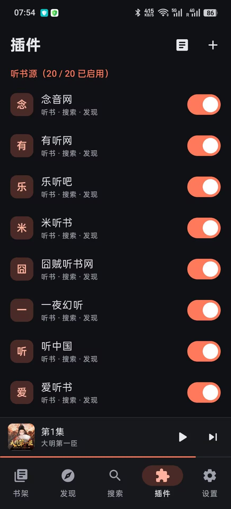

## 关于后续插件分享的说明

目前安卓版和 iOS 版已支持 MCP，电脑版也将陆续支持。通过 WorkBuddy、DeepSeek Harness、Codex 等 AI 工具连接应用，基本只需一句话，就能让 AI 协助制作、调试和安装插件。例如：

> 连接 MCP：`http://设备IP:8765/mcp`，帮我制作 `https://网站地址` 的听书源，测试通过后安装到应用中。

**鼓励大家根据自己的需求制作插件源，供自己学习和使用。**

为避免潜在的版权风险，**后续可能不再提供插件合集或下载链接**，应用本身仍将继续更新和维护。

随身听书只是播放工具，不提供音频内容。请合法使用插件，尊重内容版权，支持正版。

---

# 随身听书（安卓和ios版）

一个聚合听书工具。程序本身只是播放器，不带任何内容：听书源来自用户导入的**插件**，也可以听自己网盘和手机里的音频。

## 下载

- **安卓版 5.5**：[ssts-v5.5.apk](https://github.com/whykang/ssts--Android/releases/download/v5.5/ssts-v5.5.apk)
- **iOS 版 5.5**（未签名 ipa，需要 iOS 16 及以上）：[ssts-ios-5.5-unsigned.ipa](https://github.com/whykang/ssts--Android/releases/download/v5.5/ssts-ios-5.5-unsigned.ipa)
- **插件包 5.5**（37 个源，安卓和 iOS 通用）：[Sources-v5.5.zip](https://github.com/whykang/ssts--Android/releases/download/v5.5/Sources-v5.5.zip)
- **在线导入插件**：不用下载文件，在“插件”页选择从网址导入，填入下面的地址即可（国内网络可直接访问）

  ```
  https://gitee.com/whykan/ssxz/raw/master/Sources-v5.5.zip
  ```

- 历史版本：[Releases](https://github.com/whykang/ssts--Android/releases)

## 最近更新（5.5）

### 程序更新

- **每集独立保存播放进度**：第一集听到 12:30，第二集听到 05:00，切回各集时分别从各自的位置继续。
- **手动更换封面**：详情页菜单新增“更换封面”，可修改关键词搜索不同来源的封面，也可从本地选择图片；搜索期间即可选中候选，手动选择独立保存，不被目录刷新覆盖。
- **书籍状态**：支持手动设置连载或完本、跟随来源；完本且已有目录缓存时不自动刷新，没有缓存时正常加载，手动刷新仍然可用。
- **广播回听按日期分组**：便于按天查找节目，兼容旧插件；普通小说目录保留原有分段。
- 插件空白页的导入入口可选择从文件导入或从网址导入。
- **后台任务优化**：降低普通后台检查频率，暂停且无待处理任务时停止轮询；播放期间每 30 秒保存进度，暂停、切集等操作立即保存。定时关闭、跳过片尾和音量渐弱阶段保留必要检查精度。
- iOS 静音检测改为仅在开启“跳过静音”且实际播放时运行，并改进拖动进度的提交、等待与结果校验。

### 插件更新

- 新增 **听听 FM**：北京电台直播、节目搜索和历史回听；历史范围可选 7 天、30 天、90 天或全部，以来源实际提供的内容为准。
- 广播回听章节提供日期和时间信息，配合新版应用按日期分组，同时兼容旧版应用。

完整更新说明见 [5.5 发布说明](docs/release-5.5-mobile.md)。

## 界面预览

| 书架 | 发现 | 播放 | 插件 |
|:---:|:---:|:---:|:---:|
|  |  |  |  |

## 功能

**听书源**

- **插件**：从文件或网址导入 zip 插件包，一个插件可以包含多个源；支持启用、禁用、排序、删除，源的登录和设置，一键测试和调试日志
- **网盘**：内置夸克网盘、百度网盘、阿里云盘、115 网盘和 WebDAV，在设置里开启并登录自己的账号后使用；每个文件夹是一本书，里面的音频是章节，可以指定只看某个目录
- **本地文件**：在设置里选择手机上的一个文件夹，第一层文件夹是分类，里面的文件夹是一本本书；没有封面图时会按书名自动找封面
- **电子书朗读**：朗读手机里的 txt、epub 电子书，可以选朗读引擎、声音和语速
- **广播电台**：插件里有“云听”的全国电台直播和回听、“全球电台”与“听听 FM”；也可以在设置里添加自己的电台

**找书**

- **发现**：按源浏览分类，一键切换听书源，滚动到底自动加载下一页，封面网格 / 列表两种显示
- **聚合搜索**：多个源同时搜索，结果按源筛选；需要人机验证的源可以在应用内完成验证
- **书架**：收藏的书和最近播放，记住每本书及每一集的播放位置，支持分类与连载 / 完本状态
- **云同步**：通过坚果云（WebDAV）在安卓、iOS、Mac 之间同步书架、播放记录、听书进度和书签

**播放**

- 后台播放，通知栏 / 锁屏 / 耳机控制
- 每集独立断点续播、自动播放下一集
- 倍速 0.5x – 3x、音量 0 – 500%，每本书记住自己的倍速和音量；可以跳过静音
- 下载到本机离线听，可以按区间下载；播放时自动预缓存后面几集
- 书签：记下某一集的某个位置，可以写备注
- 快进快退（步长可调）
- 定时关闭：本集结束后、播完几集、预设时长或自定义分钟数，结束前音量渐弱，摇一摇重新计时
- 单书跳过片头片尾
- 章节倒序、按标题筛选、定位到上次听到的位置

**界面**

- 浅色、深色、跟随系统
- 7 种主题色

## 插件

这个仓库放的是插件相关的部分：开发文档、示例插件的源码和打好的插件包。

- 📦 [plugins/dist/ShunSources.zip](plugins/dist/ShunSources.zip)：打好的插件包（5.5，37 个源），下载后在 App 的“插件”页点 `+` →“从文件导入 zip”

- 📖 [插件开发指南](docs/plugin-development.md)：插件包结构、源的写法、宿主提供的能力、调试和打包
- 🧩 [plugins/ShunSources](plugins/ShunSources)：示例插件的源码，覆盖了文档里提到的大部分写法

插件是一个 zip，里面放一个 `manifest.json` 和若干 JavaScript 脚本，脚本里用 `registerSource({...})` 注册源：

```js
registerSource({
  id: '0f9c0b5c2d7e4c1b9a0e6f3a2b1c4d5e',
  name: '我的站点',
  url: 'https://example.com',

  search: function (keywords, page) {
    var doc = this.host.getHtml('https://example.com/search?q=' + encodeURIComponent(keywords) + '&p=' + page);
    var books = doc.select('.item').map(function (e) {
      return { coverUrl: e.first('img').absUrl('src'), bookUrl: e.first('a').absUrl('href'), title: e.first('h3').text() };
    });
    return { books: books, totalPage: page };
  },

  bookDetail: function (bookUrl) {
    var doc = this.host.getHtml(bookUrl);
    return { episodes: doc.select('#playlist a').map(function (a) { return { title: a.text(), url: a.absUrl('href') }; }) };
  },

  audio: function (episodeUrl) {
    return this.host.getHtml(episodeUrl).first('audio').absUrl('src');
  }
});
```

完整说明见[插件开发指南](docs/plugin-development.md)。

## 说明

本程序只是播放器，不提供任何内容，所有音频都来自插件访问的第三方网站或用户自己的网盘和文件，请支持正版。
插件脚本会在本机访问网络，请只导入你信任的来源提供的插件。
