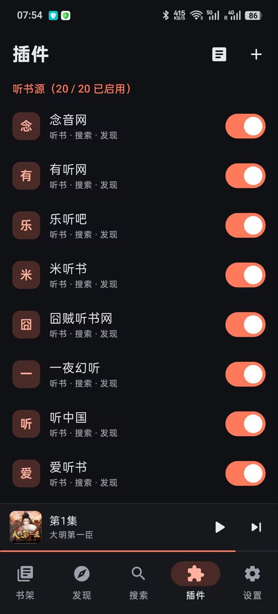

## 随身听书 iOS 版现已上架 App Store

**支持中国大陆及其他地区的 App Store，欢迎下载体验！**

在 App Store 搜索「随身听书」，或扫描下方二维码下载。也可以[点击这里直接前往 App Store](https://apps.apple.com/cn/app/随身听书/id6833734340)。

<a href="https://apps.apple.com/cn/app/随身听书/id6833734340">
  
</a>

---

## 关于后续插件分享的说明

目前安卓版和 iOS 版以及电脑版均已支持 MCP，通过 WorkBuddy、DeepSeek Harness、Codex 等 AI 工具连接应用，基本只需一句话，就能让 AI 协助制作、调试和安装插件。例如：

> 连接 MCP：`http://设备IP:8765/mcp`，帮我制作 `https://网站地址` 的听书源，测试通过后安装到应用中。

**鼓励大家根据自己的需求制作插件源，供自己学习和使用。**

为避免潜在的版权风险，**后续可能不再提供插件合集或下载链接**，应用本身仍将继续更新和维护。

---

# 随身听书（安卓和ios版）

一个聚合听书工具。程序本身只是播放器，不带任何内容：听书源来自用户导入的**插件**，也可以听自己网盘和手机里的音频。

## 下载

- **安卓版 5.8**：[ssts-v5.8.apk](https://github.com/whykang/ssts--Android/releases/download/v5.8/ssts-v5.8.apk)
- **iOS 版 5.8**（未签名 ipa，需要 iOS 15 及以上，低版本兼容性未充分测试）：[ssts-ios-5.8-unsigned.ipa](https://github.com/whykang/ssts--Android/releases/download/v5.8/ssts-ios-5.8-unsigned.ipa)
- **插件包 5.7**（Android / iOS / Mac / Windows 通用）：[Sources-v5.7.zip](https://github.com/whykang/ssts--Android/releases/download/v5.7/Sources-v5.7.zip)
- **在线导入插件**：不用下载文件，在“插件”页选择从网址导入，填入下面的地址即可（国内网络可直接访问）

  ```
  https://gitee.com/whykan/ssxz/raw/master/Sources-v5.7.zip
  ```

- 历史版本：[Releases](https://github.com/whykang/ssts--Android/releases)

## 最近更新（5.8）

### 安卓 & iOS 共同更新

- **支持更多音频格式**：扩展音频解码兼容，支持 WMA 等更多音频格式播放。
- **电子书朗读增强**：支持朗读净化、发音替换词典、TXT 预设与自定义正则分章规则。
- **电子书全屏原文与目录**：新增全屏原文阅读（实时高亮当前朗读句、自动滚动、点句跳转、字号调节），支持在原文页顶部打开目录切换章节，并优化播放页按钮布局。
- **电子书朗读独立分组**：将「电子书朗读」从「内置源」移出为单独设置分组，未选文件夹时也可直接配置与试听。
- **多文件夹支持**：本地文件与电子书朗读均支持添加多个文件夹，支持单个更换、重命名与移除。
- **同一网盘多账号登录**：支持为同一个网盘添加并登录多个独立账号。
- **新增 SMB（SMB2/SMB3）**：支持添加多个局域网共享账号、一键获取共享列表选择、流媒体播放与封面加载。
- **WebDAV / SMB 先测后存**：新增连接测试流程，测试通过后才显示保存按钮，并完善中文错误提示。
- **目录与下载增强**：章节目录显示播放进度百分比；下载支持全部一键下载与一键暂停。
- **缓存上限自动清理**：支持设置预缓存大小上限，超出后自动清理旧缓存。
- **支持更换应用图标**：新增 9 套配色应用图标供自由切换（安卓切换前弹窗提示重启生效）。

### 安卓专属更新

- **小组件封面取色**：桌面小组件支持根据当前书籍封面动态提取配色。
- **默认开启动态取色**：移除节日主题风格设置，默认开启系统动态取色（可在设置中关闭）。

### iOS 专属更新

- **系统版本兼容**：最低支持系统版本降至 iOS 15（未充分测试，低版本可能存在部分功能异常）。
- **系统朗读重构升级**：改为按句流式合成与无缝衔接播放，首句就绪即开播，修复后台合成卡死问题。

## 界面预览

| 书架 | 发现 | 播放 | 插件 |
|:---:|:---:|:---:|:---:|
|  |  |  |  |

## 功能

**听书源**

- **插件**：从文件或网址导入 zip 插件包，一个插件可以包含多个源；支持启用、禁用、排序、删除，源的登录和设置，一键测试和调试日志
- **网盘**：内置夸克网盘、百度网盘、阿里云盘、115 网盘和 WebDAV，在设置里开启并登录自己的账号后使用；每个文件夹是一本书，里面的音频是章节，可以指定只看某个目录
- **本地文件**：在设置里选择手机上的一个文件夹，第一层文件夹是分类，里面的文件夹是一本本书；没有封面图时会按书名自动找封面
- **电子书朗读**：朗读手机里的 txt、epub 电子书，可以选朗读引擎、声音和语速
- **广播电台**：插件里有“云听”的全国电台直播和回听、“全球电台”与“听听 FM”；也可以在设置里添加自己的电台

**找书**

- **发现**：按源浏览分类，一键切换听书源，滚动到底自动加载下一页，封面网格 / 列表两种显示
- **聚合搜索**：多个源同时搜索，结果按源筛选；需要人机验证的源可以在应用内完成验证
- **书架**：收藏的书和最近播放，记住每本书及每一集的播放位置，支持分类与连载 / 完本状态
- **云同步**：通过坚果云（WebDAV）在安卓、iOS、Mac 之间同步书架、播放记录、每集进度、书签和手动封面；可选同步插件及删除记录，默认关闭

**播放**

- 后台播放，通知栏 / 锁屏 / 耳机控制
- 每集独立断点续播；自动续播下一集从头开始，手动选集恢复进度；目录显示收听状态
- 倍速 0.5x – 3x、音量 0 – 500%，每本书记住自己的倍速和音量；可以跳过静音
- 下载到本机离线听，可以按区间下载；播放时自动预缓存后面几集
- 书签：记下某一集的某个位置，可以写备注
- 快进快退（步长可调）
- 定时关闭：本集结束后、播完几集、预设时长或自定义分钟数，结束前音量渐弱，摇一摇重新计时
- 单书跳过片头片尾
- 章节倒序、按标题筛选、定位到上次听到的位置

**界面**

- 浅色、深色、跟随系统
- 7 种主题色

## 插件

这个仓库放的是插件相关的部分：开发文档、示例插件的源码和打好的插件包。

- 📦 [Sources-v5.7.zip](https://github.com/whykang/ssts--Android/releases/download/v5.7/Sources-v5.7.zip)：打好的插件包（5.7），下载后在 App 的“插件”页点 `+` →“从文件导入 zip”

- 📖 [插件开发指南](docs/plugin-development.md)：插件包结构、源的写法、宿主提供的能力、调试和打包
- 🧩 [plugins/ShunSources](plugins/ShunSources)：示例插件的源码，覆盖了文档里提到的大部分写法

插件是一个 zip，里面放一个 `manifest.json` 和若干 JavaScript 脚本，脚本里用 `registerSource({...})` 注册源：

```js
registerSource({
  id: '0f9c0b5c2d7e4c1b9a0e6f3a2b1c4d5e',
  name: '我的站点',
  url: 'https://example.com',

  search: function (keywords, page) {
    var doc = this.host.getHtml('https://example.com/search?q=' + encodeURIComponent(keywords) + '&p=' + page);
    var books = doc.select('.item').map(function (e) {
      return { coverUrl: e.first('img').absUrl('src'), bookUrl: e.first('a').absUrl('href'), title: e.first('h3').text() };
    });
    return { books: books, totalPage: page };
  },

  bookDetail: function (bookUrl) {
    var doc = this.host.getHtml(bookUrl);
    return { episodes: doc.select('#playlist a').map(function (a) { return { title: a.text(), url: a.absUrl('href') }; }) };
  },

  audio: function (episodeUrl) {
    return this.host.getHtml(episodeUrl).first('audio').absUrl('src');
  }
});
```

完整说明见[插件开发指南](docs/plugin-development.md)。

## 说明

本程序只是播放器，不提供任何内容，所有音频都来自插件访问的第三方网站或用户自己的网盘和文件，请支持正版。
插件脚本会在本机访问网络，请只导入你信任的来源提供的插件。
